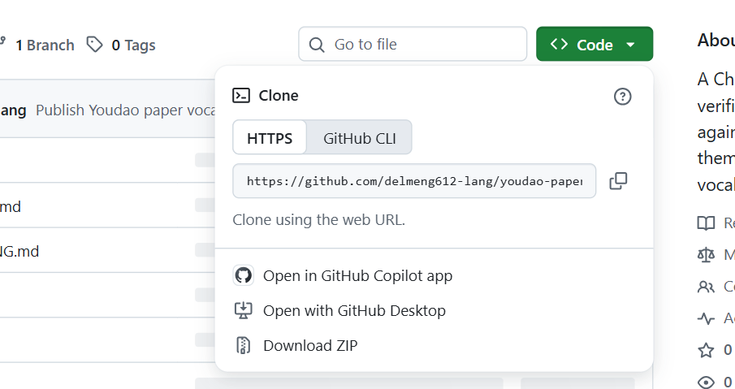
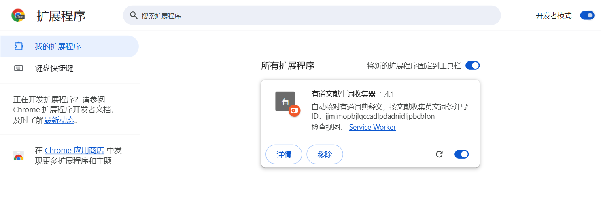
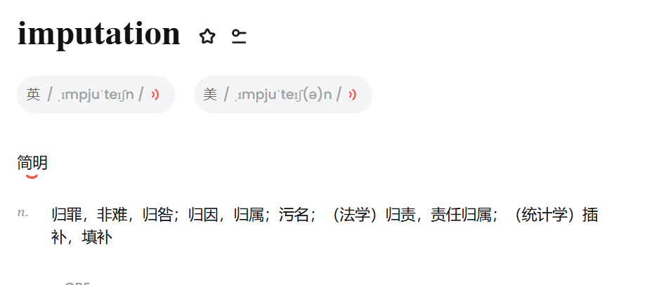
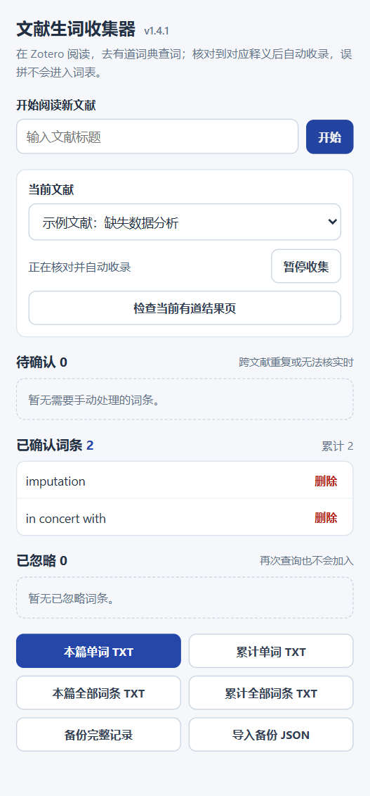
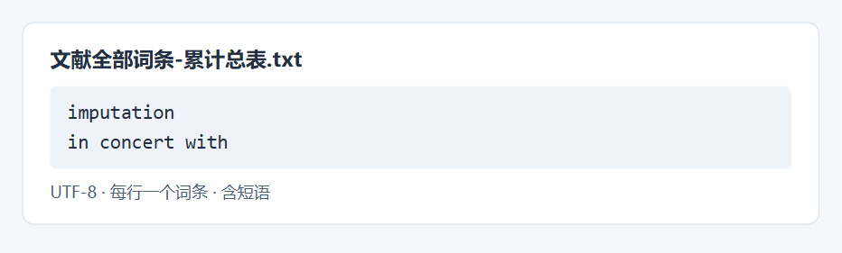

# 有道文献生词收集器 · 图文上手

这份指南以 v1.4.1 和一篇示例文献为例。你只需先选文献，然后照常去有道查词。核实成功的词条会自动进入这篇文献的词表。

## 1. 下载并解压

在仓库首页点绿色的 **Code**，再点 **Download ZIP**。解压后，找到里面直接包含 `manifest.json` 的文件夹。

## 2. 加载扩展

在 Chrome 地址栏输入 `chrome://extensions`。Edge 对应 `edge://extensions`。开启**开发者模式**，点**加载未打包的扩展程序**（不同浏览器可能叫「加载解压缩的扩展」），选中上一步的文件夹。看到「有道文献生词收集器」卡片，即表示加载成功。

点浏览器工具栏右上角的拼图图标，找到「文献生词收集器」，点旁边的图钉固定它。之后点击工具栏上的扩展图标即可打开面板。

## 3. 开始一篇文献

打开扩展面板，在**开始阅读新文献**下输入标题，例如「示例文献：缺失数据分析」，点**开始**。面板显示「正在核对并自动收录」后，就可以去有道查词了。切回之前读过的文章时，直接用**当前文献**下拉框切换。

## 4. 去有道查词

在[有道词典](https://youdao.com/)输入 `imputation` 并提交。扩展看到匹配的词条标题和「简明」释义后，会自动收录。用同样的方法查询短语 `in concert with`，短语也会进入词表。

同一篇文献里重复查 `imputation` 只保留一条。若误查成 `imputatoin`，有道显示未找到对应词条时，扩展会跳过。遇到跨文献重复或无法自动核实的词条时，可在**待确认**里决定是否收录。

## 5. 检查词表并导出

重新打开扩展面板。示例中的**已确认词条**显示 2 条，**待确认**显示 0 条。含有短语时，选**本篇全部词条 TXT**或**累计全部词条 TXT**。只准备单词时，选对应的**单词 TXT**。

下面是示例「累计全部词条 TXT」的内容。它采用 UTF-8 编码，每行一个词条。「累计单词 TXT」在本例中只包含 `imputation`，可以先用这样的少量单词试传到不背单词。

**漏收时**，先确认已选对文献且收集未暂停。刷新有道结果页，再点**检查当前有道结果页**。要换浏览器或移动扩展目录时，先点**备份完整记录**保存 JSON。

[返回 README](README.md)
